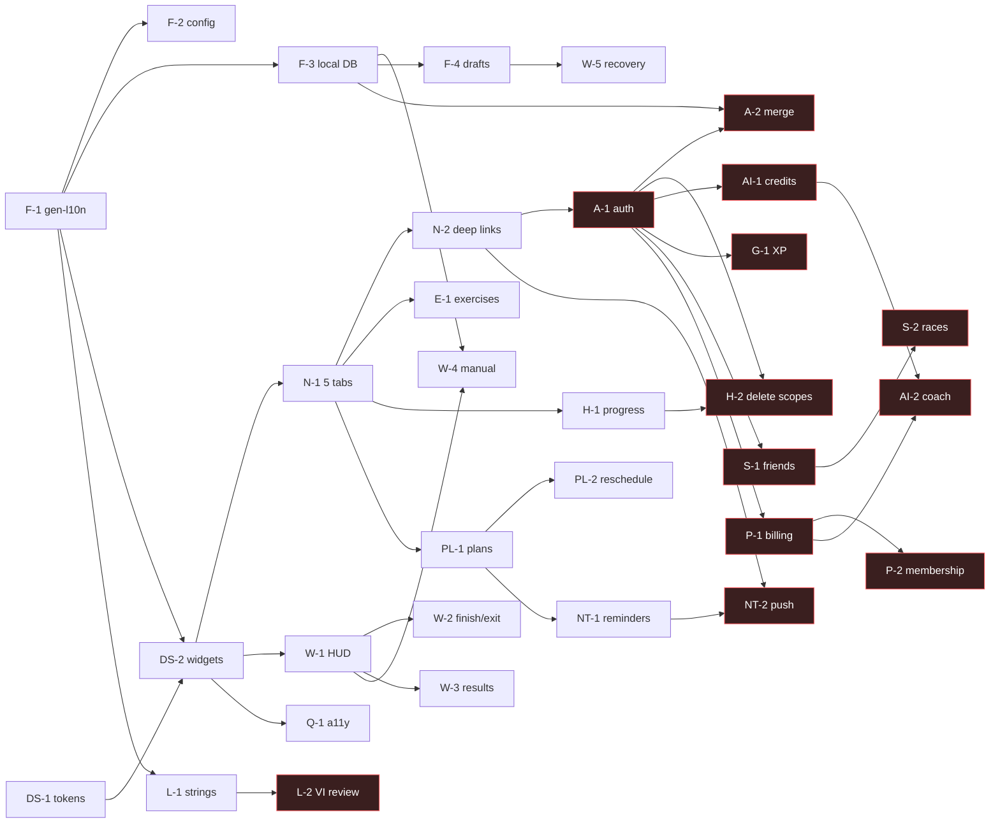

# 01 · Task dependencies and PR sequence

Source of truth for task IDs and acceptance criteria: `docs/design/v2-final-c/handoff/FLUTTER_IMPLEMENTATION_ROADMAP.md` (33 tasks). This file only adds the dependency graph, eligibility and the actual PR order. Where it differs from the roadmap or the brief, the reason is stated in §4.

## 1 · The 33 tasks

| ID | Title (short) | Depends on (roadmap) | Extra gate | Eligibility now |
|---|---|---|---|---|
| F-1 | gen-l10n infrastructure | — | — | ELIGIBLE |
| F-2 | Build metadata + config placeholders | F-1 | D-14 values stay unresolved (defaults = shipping values) | ELIGIBLE |
| F-3 | Local DB for workouts + migration | F-1 | **D-16** (local DB) | DECISION NEEDED (user-data migration) |
| F-4 | Workout draft persistence | F-3 | D-06 (12 h, proposed) | WAITS F-3 |
| DS-1 | Theme tokens to Final C | — | D-25, D-26 | ELIGIBLE |
| DS-2 | Shared widgets | DS-1, F-1 | D-24 | ELIGIBLE after DS-1, F-1 |
| N-1 | 5-tab shell | DS-2 | D-15 (router) | ELIGIBLE (without go_router, see §4) |
| N-2 | Deep links + `returnTo` | N-1 | D-15; universal-link domain | PARTIAL (custom scheme only); defer |
| A-1 | Auth + guest state machine | N-2 | **D-12**, backend auth | BLOCKED |
| A-2 | Guest → account merge | A-1, F-3 | backend sync API | BLOCKED |
| E-1 | Exercises tab | N-1 | D-28 | ELIGIBLE after N-1 |
| W-1 | HUD restyle (no engine change) | DS-2 | replay CI mandatory | ELIGIBLE after DS-2 |
| W-2 | Hold-to-finish, Back sheet, idempotent finish | W-1 | — | ELIGIBLE after W-1 |
| W-3 | Results v2 + AI card states + share toggles | W-1 | — | ELIGIBLE after W-1 |
| W-4 | Manual tracking + guided timer | W-1, F-3 | D-18 | WAITS F-3 |
| W-5 | Recovery screen | F-4 | D-06 | WAITS F-4 |
| PL-1 | Multi-day plan | N-1 | — | ELIGIBLE after N-1 |
| PL-2 | Reschedule missed session | PL-1 | — | ELIGIBLE after PL-1 |
| H-1 | Progress tab split from History | N-1 | D-05 | ELIGIBLE after N-1 |
| H-2 | Delete scopes + tombstones | H-1, F-3, A-1 | account scope needs backend | BLOCKED (account scope) |
| AI-1 | Credits ledger client | A-1 | backend credits API, D-08 | BLOCKED |
| AI-2 | Coach chat + contextual paywall | AI-1, P-1 | backend | BLOCKED |
| G-1 | Server XP / achievements sync / challenges | A-1 | backend XP | BLOCKED |
| S-1 | Friends, requests, block/report | A-1 | backend social | BLOCKED |
| S-2 | Races, leaderboards | S-1 | backend | BLOCKED |
| P-1 | StoreKit / Play Billing + server verification | A-1 | **D-13, D-14**, backend verify | BLOCKED |
| P-2 | Membership / restore / rewarded ads | P-1 | ad SDK + policy | BLOCKED |
| NT-1 | Local reminders + permission flow | PL-1 | D-19 | ELIGIBLE after PL-1 |
| NT-2 | Push + inbox + deep links | NT-1, N-2 | backend push, APNs/FCM config | BLOCKED |
| L-1 | Migrate inline strings to ARB keys | F-1 | — | ELIGIBLE after F-1 (split into several PRs) |
| L-2 | Native VI review + parameterise sample strings | L-1 | native reviewer | BLOCKED (human review) |
| Q-1 | Accessibility pass | DS-2 | device VoiceOver/TalkBack | PARTIAL (code fixes yes; device checks UNVERIFIED) |
| Q-2 | Release readiness gate | all | owner authorisation | NOT IN SCOPE while owner is away (no release) |

## 2 · Dependency graph

## 3 · PR sequence actually executed

PRs are stacked because the owner is away and nothing is merged: each PR's base is the previous task branch, stated in its description. When the owner merges bottom-up, GitHub retargets the next PR to `main`.

| # | Task | Branch | Base |
|---|---|---|---|
| 0 | W0 baseline docs | `claude/nifty-pascal-mcj79r` | `main` |
| 1 | DS-1 | `claude/v2-ds1-tokens` | #0 |
| 2 | F-1 | `claude/v2-f1-gen-l10n` | #1 |
| 3 | F-2 | `claude/v2-f2-build-config` | #2 |
| 4 | DS-2 | `claude/v2-ds2-shared-widgets` | #3 |
| 5 | N-1 | `claude/v2-n1-five-tabs` | #4 |
| 6+ | E-1 → H-1 → W-1 → W-2 → W-3 → PL-1 → PL-2 → NT-1 → L-1 (slices) → Q-1 | `claude/v2-<id>-<slug>` | previous |

Live status per PR is kept in `03_DECISION_LOG.md` (§ PR log).

## 4 · Deviations from the roadmap and the brief

1. **DS-1 before F-1.** Both have no prerequisites; the owner asked for design foundations first. Order of the two does not change any dependency.
2. **N-1 without `go_router`.** D-15 is only PROPOSED. The 5-tab shell is built with the existing Navigator 1.0 (one nested `Navigator` per tab inside an `IndexedStack`), which is reversible and keeps `CameraPage → ResultPage` on the root navigator. The router decision moves to N-2, where deep links actually need it.
3. **F-2 does not replace shipping legal values with placeholders.** The repo already ships a support email and privacy URL; replacing them with `[SUPPORT_EMAIL]` would break the live feedback/legal links. They become overridable `--dart-define` defaults and stay listed as "owner to confirm" (D-14). Product IDs default to empty (billing off).
4. **F-3, F-4, W-4, W-5 are held** for an explicit D-16 decision: moving every user's workout history to a new store is a data migration, which the owner asked not to run unattended. Everything that does not need it proceeds.
5. **L-1 is split** into several PRs by feature folder (394/395 call sites is too large for one reviewable PR).
6. **Q-1** delivers code-level fixes (hit areas, contrast tokens, semantics) only; VoiceOver/TalkBack/Dynamic Type on devices stay UNVERIFIED.
7. **Brief wave W2 "auth guards"** cannot ship before A-1; they are not built.
